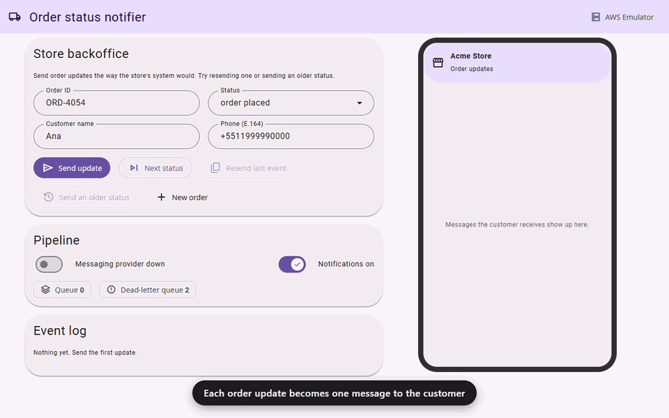
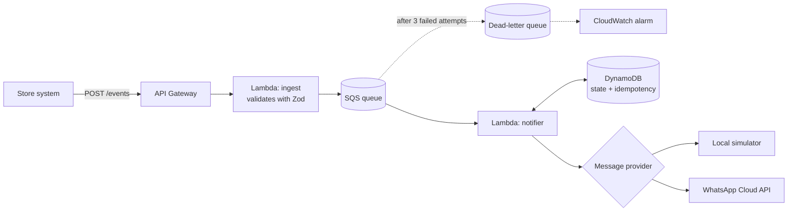

# order-status-notifier

[](https://github.com/DalmoHenrique/order-status-notifier/actions/workflows/ci.yml)

Order status notifications over a queue, built to survive the two things that always happen in event-driven systems: **the same event arrives more than once, and events arrive out of order.**

A store publishes order updates (`ORDER_PLACED` → `PAYMENT_APPROVED` → `SHIPPED` → `OUT_FOR_DELIVERY` → `DELIVERED`). Each update should become exactly one message to the customer, never a repeat and never a step backwards.

I built this after dealing with exactly that in production: a notification pipeline where an upstream service republished the same event and customers got the same message many times. Here I wanted to solve it properly on the consumer side, instead of trusting every producer to behave.



## Architecture



- **Ingest** only validates and enqueues, then answers `202`. Anything slow or flaky happens behind the queue.
- **Notifier** consumes the queue, decides whether the customer should hear about the update, and sends it.
- **Activity** (`GET /orders/{orderId}/activity`) returns what happened to every event of an order.

## How duplicates and out-of-order events are handled

The notifier has two lines of defense, both backed by DynamoDB:

1. **Order state.** Each order keeps the last status the customer was told about. A status is ranked by its position in the flow, so an update that is not further along than the current one is skipped as a `duplicate` or `out_of_order`.
2. **Conditional claim.** Before sending, the notifier writes `NOTIFICATION#<status>` with `attribute_not_exists(PK)`. When two copies of the same event race each other, only one write succeeds, and only that one sends. A failed claim can be retried, and a claim stuck in `PENDING` (a worker that died mid-send) can be taken over after 5 minutes.

I chose a standard SQS queue plus consumer-side idempotency over a FIFO queue. FIFO deduplication only covers a 5-minute window and only catches copies the producer sends with the same deduplication id. It wouldn't have caught the bug that started this project.

## Failure handling

- The notifier uses **partial batch responses** (`ReportBatchItemFailures`): one failed message doesn't make SQS redeliver the whole batch.
- A failed send is marked `FAILED`, the message becomes visible again and is retried.
- After **3 attempts** the redrive policy moves it to the **dead-letter queue**, and a CloudWatch alarm fires.
- A message that can never be valid (bad payload) is logged and dropped instead of burning retries.
- `NOTIFICATIONS_ENABLED=false` works as a kill switch without a redeploy.

## Run it locally with AWS Emulator

Everything runs on your machine. SQS and DynamoDB come from [AWS Emulator](https://docs.aws.amazon.com/emulator/latest/userguide/getting-started-docker.html), and the customer's phone is a web simulator. No AWS account and no WhatsApp setup needed.

Requirements: Node.js 22+ and Docker.

```bash
npm ci
npm run emulator:build   # builds the AWS Emulator image from the official RPM (once)
npm run emulator         # terminal 1: AWS Emulator on https://127.0.0.1:9297
npm run dev              # terminal 2: API + queue consumer + simulator
```

Open http://localhost:3000 and try:

- **Send update / Next status**: the message shows up on the phone.
- **Resend last event**: same payload, same id. It shows up as *Duplicate blocked*.
- **Send an older status**: shows up as *Older status ignored*.
- **Messaging provider down**: send something and watch it fail, retry and land in the dead-letter queue after about 30 seconds.
- **Notifications on/off**: the kill switch.

The local server wires the same Lambda handlers to an HTTP server and a queue poller that behaves like the Lambda SQS trigger (partial batch failures included). On AWS, API Gateway and the event source mapping do that job.

## Tests

```bash
npm test
```

Jest covers the parts I'd be most nervous about changing: payload validation, status ordering, the conditional writes, duplicates, out-of-order events, retries after a failure, partial batch responses, the kill switch and both message providers. AWS calls are mocked with `aws-sdk-client-mock`, so the suite runs without the emulator.

## Deploy to AWS (optional)

The infrastructure is in [`template.yaml`](template.yaml) (AWS SAM). With the SAM CLI and your own AWS credentials:

```bash
sam build
sam deploy --guided
```

It creates an HTTP API, three Lambda functions, an SQS queue with a dead-letter queue, the DLQ alarm and a DynamoDB table. For light use it costs close to nothing. `sam delete` removes everything.

## Sending real WhatsApp messages (optional)

The notifier talks to a `MessageProvider` interface. The default is the simulator. To send real messages:

1. Create an app at [Meta for Developers](https://developers.facebook.com/) and add the WhatsApp product. Meta gives you a free test number.
2. Add your own phone as a recipient.
3. Set `MESSAGE_PROVIDER=whatsapp`, `WHATSAPP_ACCESS_TOKEN` and `WHATSAPP_PHONE_NUMBER_ID`.

Business-initiated WhatsApp messages must use an approved template. `hello_world` comes approved on the test number. For a custom template, set `WHATSAPP_TEMPLATE_NAME`. The code fills three body variables: customer name, order id and status. Check Meta's docs for the current Graph API version (`WHATSAPP_API_VERSION`, default `v21.0`).

## Project structure

```
src/
  domain/      order statuses, ranking and payload validation (Zod)
  handlers/    Lambda entry points: ingest, notifier, activity
  store/       DynamoDB access: state, idempotency claims, activity log
  providers/   simulator and WhatsApp Cloud API
local/         AWS Emulator setup, local server and the web simulator
tests/         Jest suites
template.yaml  AWS SAM infrastructure
```

## What I'd add next

- A TTL on activity items so old orders clean themselves up.
- The WhatsApp token in Secrets Manager instead of a Lambda environment variable.
- Authentication on the API (an API key or a signed webhook from the store).
- A small redrive tool to replay messages from the DLQ once the provider is back.

## License

MIT
